# Visual Assist: Technical Documentation

This document explains how Visual Assist is built: its hardware, its
software, the algorithms behind the guidance, every setting, the trained
models, the demo page and the tests. It is written for someone who wants to
understand, run, check or extend the project. For a short introduction and
the list of voice commands, start with the [README](../README.md).

## Contents

1. [Overview](#1-overview)
2. [Architecture](#2-architecture)
3. [Hardware and wire protocols](#3-hardware-and-wire-protocols)
4. [Software modules](#4-software-modules)
5. [The main loop](#5-the-main-loop)
6. [Voice commands](#6-voice-commands)
7. [Perception: what is where, and how far](#7-perception-what-is-where-and-how-far)
8. [Guidance and route planning](#8-guidance-and-route-planning)
9. [Feedback and adaptation](#9-feedback-and-adaptation)
10. [Banknotes and faces](#10-banknotes-and-faces)
11. [Speech in and out, and languages](#11-speech-in-and-out-and-languages)
12. [Configuration reference](#12-configuration-reference)
13. [Models and training](#13-models-and-training)
14. [Simulation](#14-simulation)
15. [The demo page](#15-the-demo-page)
16. [Tests](#16-tests)
17. [Installing and running](#17-installing-and-running)
18. [What is verified, and known limits](#18-what-is-verified-and-known-limits)
19. [Relation to the project report](#19-relation-to-the-project-report)
20. [Extending the project](#20-extending-the-project)
21. [Repository layout](#21-repository-layout)

---

## 1. Overview

Visual Assist is a wearable aid for blind people. A camera recognises what
is in the room, a LiDAR measures how far away it is, and a voice in an
earphone tells the wearer what is there and guides them to what they ask
for, around whatever stands in the way. The wearer speaks to it: "Where is
the door?", "Guide me to the table", "What note is this?".

| At a glance | |
|---|---|
| Computer | Raspberry Pi 4 |
| Sensors | Pi Camera, TF-Luna LiDAR, USB microphone |
| Actuators | Two servos (pan and tilt) driven by an ESP8266, an earphone |
| Language | Python 3 (about 4,000 lines in the `visual_assist` package) |
| Detection | Ultralytics YOLO: a pretrained YOLOv5-nano for everyday objects, a YOLOv5-nano trained here for doors, a YOLOv8-nano classifier trained here for banknotes |
| Tests | 176, none needing hardware |
| Origin | B.Tech project report "Navigating the Unseen: A Deep Learning Based Aid for the Blind", Government College of Engineering Kannur, April 2025 |

The report describes the system but does not include source code. This
repository is a fresh implementation of that description.

**Status.** Everything here has been run on a PC: the tests, the guidance in
simulated rooms, the models on held-out photos, and the demo page. Nothing
has yet been run on the assembled device. Section 18 says exactly what has
and has not been checked.

### What it can do

| Capability | How it is done |
|---|---|
| Name objects and say where they are | YOLO detection on each picture; left, centre or right from the position in the picture |
| Find doors | A second detection model, trained for this project |
| Measure distance | The LiDAR, checked against the object's size in the picture |
| Warn of obstacles | Spoken when something is closer than a distance that grows with walking speed |
| Find one object | The head looks at five angles, then turns to the object so the LiDAR can measure it |
| Guide to an object | A LiDAR sweep, a map of obstacles, the A* shortest-path search, and one spoken action at a time |
| Adapt to the wearer | Walking speed, pauses and familiarity change how early it warns and how much it says |
| Recognise people | OpenCV's YuNet finds faces and SFace compares them with registered ones |
| Read banknotes | An image classifier for Indian notes from ₹10 to ₹2000 |
| Speak four languages | English, Malayalam, Hindi, Tamil |

---

## 2. Architecture

### 2.1 Hardware

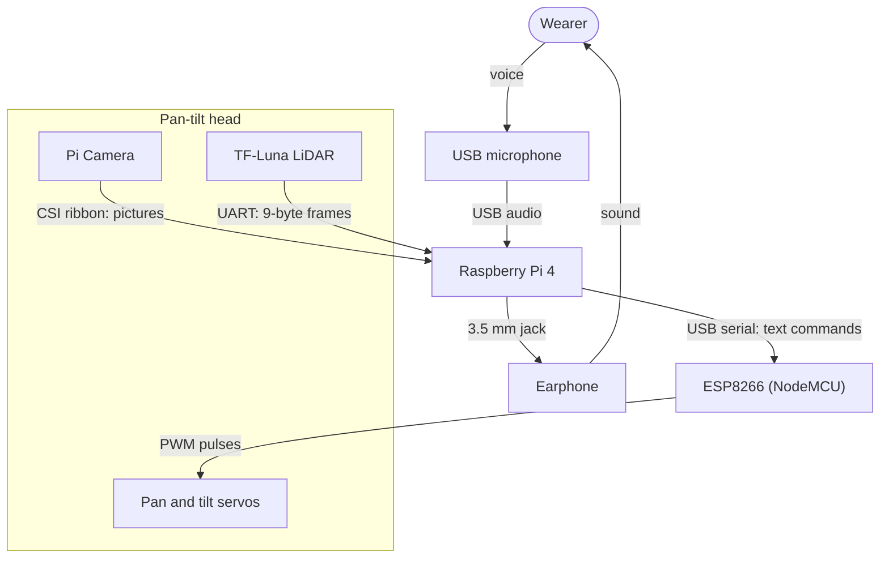

The Raspberry Pi is the only computer. The camera and the LiDAR sit
together on a pan-tilt head, pointing the same way, so the LiDAR measures
along the middle of the camera's picture, and the two servos turn them
both. The ESP8266 exists only to turn the Pi's text commands into the
pulses servos need.

### 2.2 Software

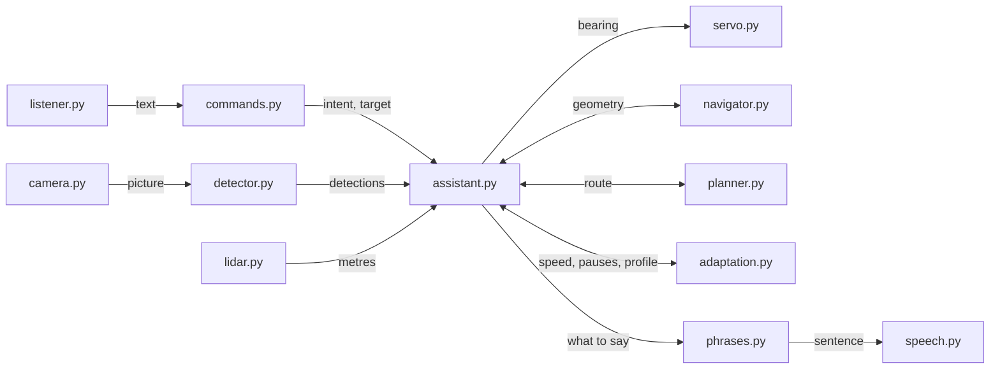

`assistant.py` is the hub. It owns the main loop, decides what to do next
and calls everything else. The modules fall into four groups:

| Group | Modules | Touches hardware |
|---|---|---|
| Devices | `camera`, `lidar`, `servo`, `listener`, `speech` | yes |
| Models | `detector`, `currency`, `faces` | no, but need their libraries |
| Reasoning | `commands`, `navigator`, `planner`, `adaptation`, `phrases` | no |
| Orchestration | `assistant`, `config` | no |

### 2.3 Design rules

- **Every device is optional.** Each device module has an `open_...()`
  function. With the setting `backend: auto` it tries the real device and
  falls back to a stand-in that does nothing (`NullLidar`, `NullPanTilt`),
  to a webcam, or to the keyboard. The assistant then does what it still
  can: without a LiDAR, distances are camera estimates; without a turning
  head, there is no sweep and no route planning.
- **The reasoning never imports hardware.** `navigator`, `planner`,
  `adaptation`, `commands` and `phrases` are plain arithmetic and text, so
  they are tested directly.
- **The assistant is handed its devices.** `Assistant(cfg, camera,
  detector, lidar, pantilt, speaker, ...)` takes them as arguments. The
  same class therefore runs on the device, in the simulator
  (`simulation.py`) and inside a web page (`live.py`), with different
  objects passed in.
- **Three threads.** The main thread does all camera, LiDAR and servo
  work. A listener thread only puts recognised text on a queue. The speaker
  has a worker thread, so a slow detection never delays speech and an
  urgent warning can cut in.

The same `Assistant` class with its three sets of devices:

| Role | On the device (`build()`) | In the simulator (`make()`) | In a web page (`LiveAssistant`) |
|---|---|---|---|
| Camera | `PiCamera` or `OpenCVCamera` | `FakeCamera` | `LiveCamera`: pictures taken by the page |
| Detector | `Detector`, `MultiDetector` (PyTorch) | `FakeDetector` | `LiveDetector`: results from the page's ONNX models |
| LiDAR | `TFLuna` | `FakeLidar` | `NullLidar` |
| Pan-tilt head | `Esp8266PanTilt` or `GpioPanTilt` | `FakePanTilt` | `NullPanTilt` |
| Speaker | `Speaker` | `FakeSpeaker` | `LiveSpeaker`: the browser's voice |
| Clock | `time.monotonic` | `Clock`, moved on by the test | `time.monotonic` |

### 2.4 Threads and queues

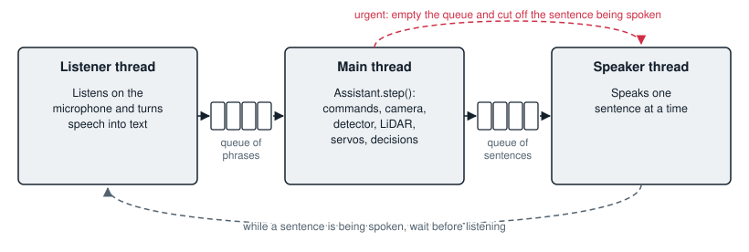

Only the main thread touches the camera, the LiDAR and the servos, so no
device is ever used by two threads at once. The two queues are the only
things the threads share.

### 2.5 Conventions

| Quantity | Convention |
|---|---|
| Bearing | Degrees from where the wearer faces. 0 is straight ahead, positive is to the right |
| Distance | Metres |
| Planner map | The wearer at (0, 0) facing +y, with +x to the right |
| Servo angle | 0 to 180. 90 is straight ahead; a larger pan angle turns the head left |
| Picture box | `(x1, y1, x2, y2)` in pixels, origin top left |

Terms used throughout: a **detection** is one object found in one picture;
a **sighting** is a detection placed relative to the wearer (label,
bearing, distance); a **leg** is one straight stretch of a planned route;
the **deadband** is the angle (15° by default) within which something
counts as straight ahead.

---

## 3. Hardware and wire protocols

### 3.1 Parts

| Part | Job | Joined to the Pi by |
|---|---|---|
| Raspberry Pi 4 (Raspberry Pi OS, 64-bit) | Runs all the software | |
| Raspberry Pi Camera Module | Pictures, 640 × 480 | CSI ribbon cable |
| TF-Luna LiDAR | Distance along the middle of the picture, 0.2 m to 8 m | UART, 115200 baud |
| ESP8266 (NodeMCU) | Turns text commands into servo pulses | USB serial, 115200 baud |
| Two SG90 servos on a pan-tilt bracket | Turn the camera and LiDAR | ESP8266 pins D5 and D6 |
| USB microphone | Spoken commands | USB |
| Earphone | Spoken replies | 3.5 mm audio jack |

### 3.2 Wiring

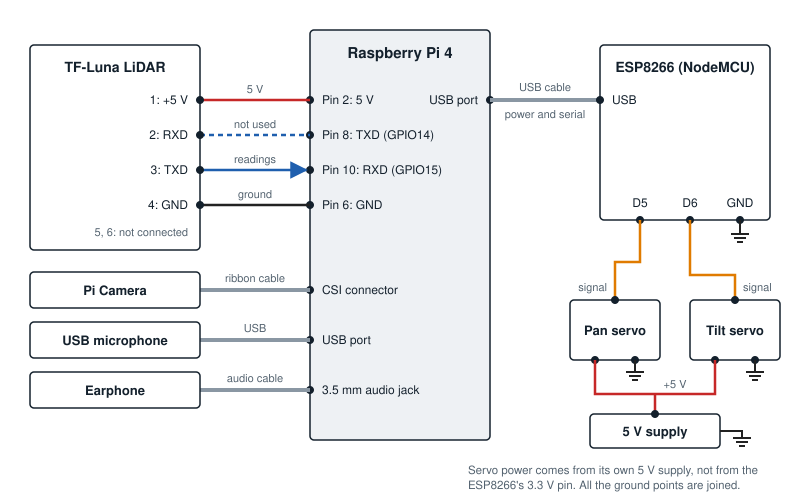

*Every wire between the parts. The LiDAR's TXD goes to the Pi's RXD: that
is the wire the readings travel on. The Pi's TXD is connected but the
software never sends the LiDAR anything.*

**TF-Luna to Raspberry Pi**

| TF-Luna pin | Raspberry Pi |
|---|---|
| 1, +5 V | Pin 2 (5 V) |
| 2, RXD | Pin 8 (GPIO14, TXD) |
| 3, TXD | Pin 10 (GPIO15, RXD) |
| 4, GND | Pin 6 (GND) |
| 5, 6 | Not connected |

**Servos to ESP8266** (the ESP8266 plugs into a USB port of the Pi)

| Servo wire | Connect to |
|---|---|
| Pan signal (orange) | D5 |
| Tilt signal (orange) | D6 |
| Power (red) | A 5 V supply, not the ESP8266's 3.3 V pin |
| Ground (brown) | GND, shared with the ESP8266 |

Mount the LiDAR so that it points the same way as the camera. The software
assumes the LiDAR measures along the centre of the picture.

### 3.3 TF-Luna frame format

Source: [`visual_assist/lidar.py`](../visual_assist/lidar.py).

The sensor sends 9-byte frames continuously at 115200 baud.

| Byte | Meaning |
|---|---|
| 1, 2 | Header, always `0x59 0x59` |
| 3, 4 | Distance in centimetres, low byte first |
| 5, 6 | Signal strength, low byte first |
| 7, 8 | Chip temperature (not used) |
| 9 | Checksum: the low byte of the sum of bytes 1 to 8 |

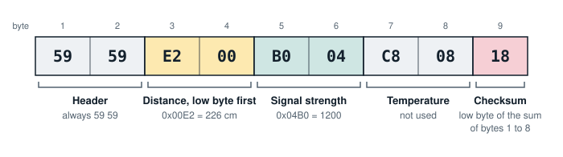

*One frame, for a reading of 2.26 m.*

In this example the distance is `0x00E2` = 226 cm and the signal strength
is `0x04B0` = 1200. The first eight bytes add up to `0x318`, whose low byte
`0x18` matches the checksum.

How a reading is taken (`TFLuna.read`):

1. Throw away what is buffered, so the reading belongs to where the head
   points now.
2. Read 9 bytes and look for a complete frame with a correct checksum
   (`find_frame`, searching from the end so the newest wins). If the read
   started in the middle of a frame, read 9 more and look again.
3. Decode it (`parse_frame`). The reading is discarded, giving `None`, if
   the signal strength is below 100 or equal to 65535, or if the distance
   is outside 0.2 m to 8.0 m.

`encode_frame` does the reverse and is used by the simulator and the tests.

### 3.4 ESP8266 command protocol

Sources: [`firmware/esp8266_pan_tilt/esp8266_pan_tilt.ino`](../firmware/esp8266_pan_tilt/esp8266_pan_tilt.ino),
[`visual_assist/servo.py`](../visual_assist/servo.py).

One command per line over USB serial at 115200 baud. Each is answered with
`OK` or `ERR`.

| Command | Effect |
|---|---|
| `PAN <0-180>` | Turn the head left or right. 90 is straight ahead |
| `TILT <0-180>` | Tilt the head up or down. 90 is level |
| `CENTER` | Both servos to 90 (the Pi's driver does not use it; it sends `PAN 90` and `TILT 90`) |

The firmware maps the angle linearly onto a pulse of 500 to 2500
microseconds: `pulse = 500 + angle × 2000 / 180`. An angle outside 0 to 180
is held to that range.

On the Pi, `look(bearing, tilt)` computes

```
pan  = clamp(pan_center - bearing)     # + bearing if servo.pan_invert
tilt = clamp(tilt_center + tilt)
```

sends `PAN` then `TILT`, and waits `servo.settle_s` (0.4 s; 0.05 s between
the steps of a sweep) for the head to stop. Example: to look 60° to the
left, the bearing is −60, the Pi sends `PAN 150`, and the ESP8266 gives the
pan servo pulses of 2167 µs.

Opening the serial port resets a NodeMCU, so the driver waits two seconds
and discards the boot messages before the first command.

**Without an ESP8266.** With `servo.backend: gpio` the servos' signal wires
go straight to the Pi (BCM pins 12 and 13 by default) and are driven by
`gpiozero` with the same pulse range.

---

## 4. Software modules

### 4.1 The modules

All in [`visual_assist/`](../visual_assist/).

| Module | Responsibility | Main contents |
|---|---|---|
| `assistant.py` | Main loop, command handlers, guidance | `Assistant`, `build()` |
| `config.py` | Settings with their defaults; loads `config.yaml` | `Config` and one dataclass per section, `load()`, `from_dict()` |
| `commands.py` | Recognised text to a command | `parse()`, `Command`, `SYNONYMS` |
| `camera.py` | Pictures from the Pi Camera or a webcam | `PiCamera`, `OpenCVCamera`, `open_camera()` |
| `detector.py` | Object detection with one model or several | `Detection`, `Detector`, `MultiDetector`, `center_detection()` |
| `lidar.py` | TF-Luna frames | `TFLuna`, `NullLidar`, `find_frame()`, `parse_frame()`, `encode_frame()` |
| `servo.py` | The pan-tilt head | `Esp8266PanTilt`, `GpioPanTilt`, `NullPanTilt` |
| `navigator.py` | Bearings, distance from size, turn wording, the next instruction | `Sighting`, `Instruction`, `visual_distance()`, `fuse_distance()`, `next_instruction()` |
| `planner.py` | Obstacle map and A* route search | `Obstacle`, `Leg`, `Route`, `obstacles_from_rays()`, `plan()` |
| `adaptation.py` | Movement tracking, the user profile, the adaptive rules | `UserProfile`, `MotionTracker`, `warn_distance()`, `verbosity()` |
| `phrases.py`, `locales/` | Every spoken sentence in four languages | `Phrases` |
| `speech.py` | Text to speech | `Speaker`, `OfflineVoice`, `GoogleVoice` |
| `listener.py` | Speech to text | `VoskListener`, `GoogleListener`, `KeyboardListener` |
| `currency.py` | Banknote recognition | `CurrencyReader`, `decide()`, `denomination()` |
| `faces.py` | Face recognition and registration | `FaceBook`, `People`, `FaceModels`, `Face`, `similarity()` |
| `simulation.py` | A simulated room, wearer and devices | `World`, `make()`, `record()`, `trace()` |
| `live.py` | The assistant fed by a web page's camera | `LiveAssistant` |

Outside the package:

| Path | What |
|---|---|
| [`main.py`](../main.py) | Command line entry point |
| [`config.yaml`](../config.yaml) | The settings in use |
| [`firmware/esp8266_pan_tilt/`](../firmware/esp8266_pan_tilt/) | Arduino sketch for the ESP8266 |
| [`training/`](../training/) | Dataset preparation and training scripts |
| [`weights/`](../weights/) | Trained models |
| [`index.html`](../index.html), [`demo/`](../demo/) | The demo page |
| [`tests/`](../tests/) | The test suite |

### 4.2 The data that passes between them

A picture goes through five kinds of record on its way to becoming a
spoken instruction. Each is a small frozen dataclass.

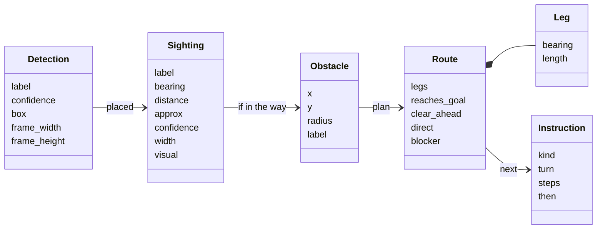

| Record | Made by | Meaning |
|---|---|---|
| `Detection` | `detector.py` | One object in one picture: what, how sure, and its box in pixels |
| `Sighting` | `Assistant._sightings()` | That object relative to the wearer: bearing and distance. `approx` marks a camera estimate; `visual` keeps the camera's own estimate for later checks |
| `Obstacle` | `planner.py` | A disc on the floor map, from a LiDAR reading or from a sighting |
| `Route`, `Leg` | `planner.plan()` | The stretches to walk, and what was found about the straight line |
| `Instruction` | `navigator.next_instruction()` | The one action to speak next; `phrases.py` turns it into a sentence |

---

## 5. The main loop

`Assistant.run()` says "Visual Assist is ready", starts the listener
thread, and calls `step()` until told to stop.

### 5.1 One step

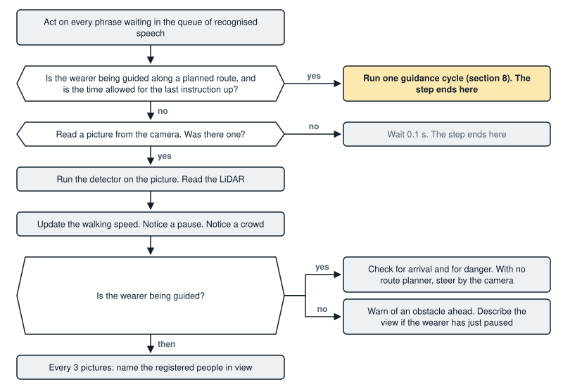

*One pass of `step()`. A pointed box is a question; a box on the right is where that answer leads.*

In words, one `step()` does this:

1. **Commands.** Take every phrase waiting on the queue and act on it
   (section 6).
2. **Planned guidance.** If the wearer is being guided along a planned
   route and the time allowed for the last instruction has passed, run one
   guidance cycle (section 8) and return.
3. **Look.** Read one picture. Run the detector. Read the LiDAR.
4. **Movement.** Update the walking speed and notice a pause (section 9).
5. **Crowd.** Three or more people in view is announced once as crowded.
6. **React.**
   - While guiding: check for arrival and for danger. Where no route can
     be planned, this step is the guidance itself, steering by the camera.
   - Otherwise: warn of an obstacle ahead, and describe the view to a
     hesitant wearer who has just stopped.
7. **Faces.** Every third picture, name the registered people in view.
8. **Preview.** With `--show`, draw the boxes and the LiDAR reading in a
   window.

The listener thread waits until the assistant has finished speaking, so it
never transcribes the assistant's own voice, then listens and queues what
it heard.

On exit, `close()` saves the user profile, centres the head, lets the
speaker finish, and closes the devices.

### 5.2 A command from start to finish

What happens between the wearer asking "Where is the door?" and hearing the
answer. Sections 6 and 7 explain each part.

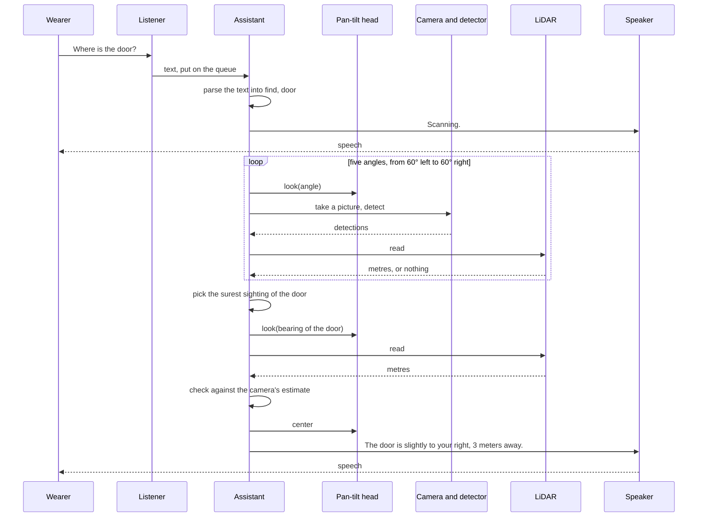

On the wire, each `look()` is two lines of text to the ESP8266 (`PAN`,
`TILT`) and each LiDAR `read` is one 9-byte frame (section 3). The demo
page's "Inside the device" section plays this same sequence with the real
messages.

---

## 6. Voice commands

Source: [`visual_assist/commands.py`](../visual_assist/commands.py).
Commands are spoken in English whatever language the replies are in.

`parse(text, labels)` lowercases the text, strips punctuation, and tests it
against these rules in order. The first match wins.

| Order | Intent | Triggered by | Target |
|---|---|---|---|
| 1 | `exit` | The whole phrase is one of: exit, quit, shut down, shutdown, power off, goodbye | |
| 2 | `language` | A language name with speak, talk, language, say, switch or change, or the name alone | `en`, `ml`, `hi`, `ta` |
| 2 | `verbosity` | speak less, be brief; more detail, tell me more; normal detail | `brief`, `detailed`, `normal` |
| 2 | `rate` | speak faster, too slow; speak slower, too fast | `faster`, `slower` |
| 2 | `warn` | warn me earlier; warn me later, fewer warnings | `earlier`, `later` |
| 3 | `stop` | stop, cancel | |
| 4 | `repeat` | repeat, say that again, pardon, come again | |
| 5 | `register` | register, remember, save this | The name after "as", "named" or "called", if given |
| 6 | `who` | who | |
| 7 | `money` | money, note, rupee, rupees, currency, cash | |
| 8 | `guide` | guide me, take me, lead me, navigate, go to, bring me | The object named |
| 9 | `find` | where, find, locate, is there, look for, search for | The object named |
| 10 | `find` or `distance` | how far, distance | `find` if a known object is named, otherwise `distance` to whatever is ahead |
| 11 | `scan` | scan, around, describe, surroundings, in front, what do you see | |
| 12 | `help` | help, what can you do | |

**Naming an object.** The target is the longest known label found in the
phrase, singular or plural. Everyday words are mapped to the detector's
labels first: desk to table, mug to cup, couch and settee to sofa, seat to
chair, doorway to door, man, woman and someone to person. If no known label
is found, the words after "the", "a", "my" or "to" are taken, so that
"where is the kitchen" can be answered with "I have not been trained to
recognise kitchen".

**Speech that is not a command** is ignored in silence, because a
microphone overhears a great deal. If `listener.wake_word` is set (for
example `assistant`), only phrases containing that word are obeyed, and one
that contains it but is not understood gets a spoken "not understood".

Each intent is handled by the method `Assistant._cmd_<intent>`.

---

## 7. Perception: what is where, and how far

### 7.1 Detection

Source: [`visual_assist/detector.py`](../visual_assist/detector.py).

Two models run on every picture and their results are pooled
(`MultiDetector`):

| Model | Finds | Confidence | Input size |
|---|---|---|---|
| `weights/yolov5nu.pt` | 80 everyday objects (COCO) | 0.35 | 640 |
| `weights/doors.pt` | Doors only (its other classes are dropped) | 0.4 | 512 |

Some class names are replaced by the words people use: couch to sofa,
dining table to table, tv to television, potted plant to plant, cell phone
to phone.

Each result is a `Detection`: label, confidence, box, and the picture's
size. From these it derives:

- `position`: left, center or right, by which third of the picture the
  middle of the box is in;
- `spans_center`: whether the middle column of the picture, where the
  LiDAR points, falls on the box;
- `fills_frame`: whether the box runs off all four sides, which means the
  camera is right in front of the object.

`center_detection()` picks the detection the LiDAR beam is most likely
hitting: of those spanning the centre, the one whose middle is nearest it.

### 7.2 Bearing from a pixel

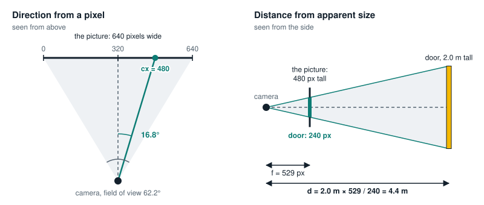

*The geometry behind this section (left) and the next (right).*

```
bearing = atan( (cx - W/2) / (W/2) × tan(HFOV / 2) )
```

`cx` is the column of the middle of the box, `W` the picture width, and
`HFOV` the camera's horizontal field of view (62.2° for the Pi Camera
Module V2). Added to the angle the head is turned to, this gives the
object's bearing from the wearer.

### 7.3 Distance from apparent size

Source: `visual_distance()` in [`navigator.py`](../visual_assist/navigator.py).

An object of known real size looks smaller the further away it is:

```
focal_px = (H / 2) / tan(VFOV / 2)
distance = real_height × focal_px / height_px
```

Example: a door (2.0 m tall) that is 240 pixels tall in a 480-pixel picture
with a vertical field of view of 48.8° is `2.0 × 529 / 240` = 4.4 m away.

Rules:

- Height is used when the whole height is in the picture. Close up, an
  object is taller than the picture, and its width is used instead.
- A box within 2 pixels of the picture's edge is taken to be cut off on
  that side. An object cut off both ways gives no estimate.
- Only objects whose size varies little are listed. Tables and sofas come
  in every size, so the camera alone cannot say how far they are.

| Object | Height (m) | Width (m) |
|---|---|---|
| door | 2.0 | 0.9 |
| person | 1.65 | 0.5 |
| refrigerator | 1.7 | 0.7 |
| chair | 0.9 | 0.5 |
| bottle | 0.25 | 0.08 |
| cup | 0.1 | 0.08 |

### 7.4 Combining the LiDAR and the camera

Source: `fuse_distance()`.

The LiDAR is exact, but it measures whatever its beam hits. Aimed at a
door, it may be stopped by a chair in front of the door.

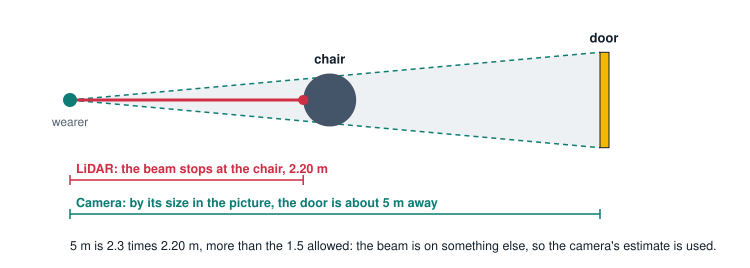

*The case the check exists for, with the figures from the demo's "chair in
the way" room.*

So each reading is compared with the camera's estimate:

| LiDAR reading | Camera estimate | Distance used | Spoken as |
|---|---|---|---|
| none | none | unknown | no distance |
| none | available | the camera's | "about 4.5 meters" |
| available | none | the LiDAR's | "2.4 meters" |
| both, within a factor of 1.5 of each other | | the LiDAR's | "2.4 meters" |
| both, further apart than that | | the camera's | "about 5 meters" |

A camera estimate is rounded to the nearest half metre and always spoken
with "about".

### 7.5 Looking around

A **scan** (`_scan`) turns the head to five angles (−60°, −30°, 0°, 30°,
60°) and at each takes a picture, runs detection and reads the LiDAR. The
LiDAR reading is credited only to the detection on the camera's axis.

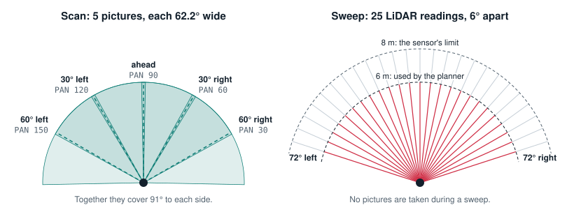

*A scan (left) finds what is in the room and where. A sweep (right, used
by route planning in section 8.2) finds where the obstacles are.*

When the same kind of object is reported in more than one view, `_pick`
chooses: the most confident report decides where the object is; among the
views within 15° of that, the one with a measured distance wins, then the
one where the object was nearest the middle of the picture.

To **measure** an object whose distance is not yet exact (`_range`), the
head turns to its bearing (at most 90° either way), the LiDAR is read, and
the reading is combined with the camera's estimate as in 7.4.

---

## 8. Guidance and route planning

Sources: [`assistant.py`](../visual_assist/assistant.py) (`_plan_route`,
`_obstacles`, `_instruct`), [`planner.py`](../visual_assist/planner.py),
[`navigator.py`](../visual_assist/navigator.py) (`next_instruction`).

"Guide me to the door" first finds and measures the door as in section 7.
If the door is already within reach, the assistant says so. Otherwise
guidance begins, and repeats the cycle below after every instruction until
the wearer arrives. Because the whole cycle runs again each time, a turn
that was too wide or a step that was too short is corrected as it happens.

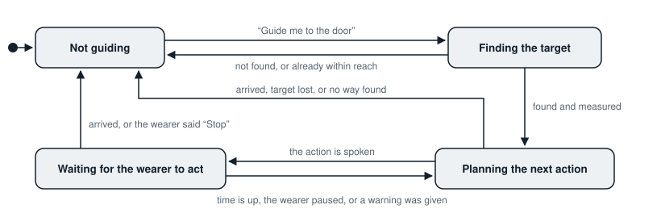

*The states of guidance. "Planning" is one pass through the cycle in 8.1;
"waiting" is the main loop of section 5 carrying on while the wearer turns
or walks.*

### 8.1 One guidance cycle

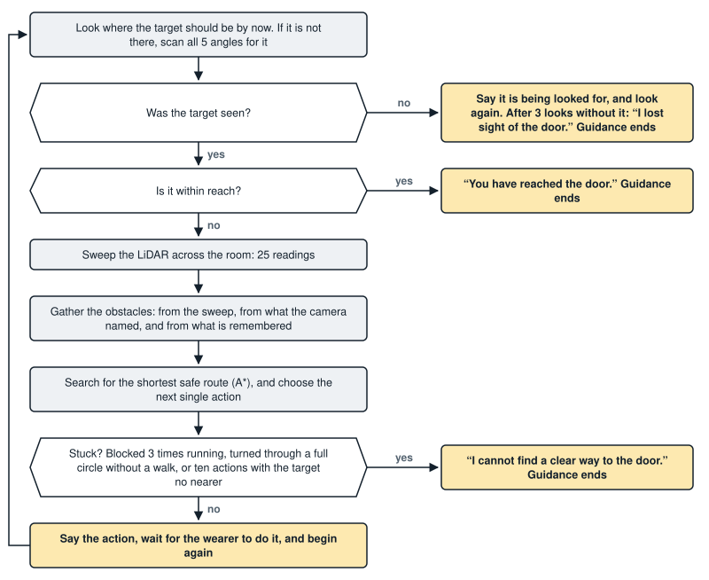

*One guidance cycle. The sections below take its steps in turn; 8.6 says
more about being stuck.*

### 8.2 Obstacles

Three sources are put together (`_obstacles`):

1. **The sweep.** The head turns from −72° to +72° in 6° steps and the
   LiDAR is read at each: 25 readings. Each hit within 6 m becomes a disc
   (`obstacles_from_rays`). Two hits on one wall are `distance × step`
   apart, so each disc is given half of that as its radius (0.25 m at
   most); otherwise a wall would look like a row of posts to walk between.
   Neighbouring hits that are no further apart than a slanted wall would
   put them are joined with extra discs every 0.2 m. A bigger jump is the
   edge of an object with open floor beside it, and is left open.
2. **The camera.** Every object named in the latest look, other than the
   target, becomes a disc sized from how wide it looked (radius 0.1 m to
   0.75 m), centred one radius beyond its near face. These carry a name,
   which is how the wearer can be told "Chair in the way".
3. **Memory.** A sweep sees only what is in front. When the wearer turns
   on the spot, what was found before is still there, at another angle.
   Obstacles are remembered by their direction relative to the target,
   which does not move, and put back wherever the target is seen next. The
   memory is dropped as soon as the wearer walks.

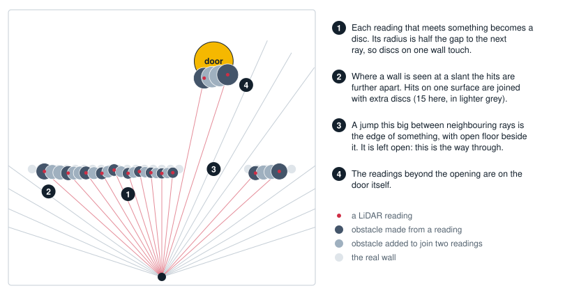

*A sweep turned into obstacles, in the demo's "wall with an opening" room.
Computed by `obstacles_from_rays()`.*

### 8.3 The map and the search

`plan()` builds a grid of 10 cm cells covering the floor from the wearer to
1.5 m beyond the target, and 1.5 m behind the wearer.

- **Blocked cells.** Every cell within `radius + 0.35 m` of an obstacle's
  centre is blocked. The 0.35 m is the clearance: half the width a walking
  person needs.
- **Soft margin.** The next 0.3 m is free but costs more to cross, up to
  three times as much right at the blocked edge. The route therefore keeps
  a little further away where that costs little.
- **The target itself.** Obstacles within reach of the target are the
  target's own surface. They do not block the route, or the destination
  would be walled off.
- **The wearer's own position** is always free.
- **Unmeasured space is treated as free.** This is safe because the wearer
  is only ever told to walk in a direction the sweep has just covered.

The search is A* over the grid, moving to any of the eight neighbouring
cells, never cutting diagonally between two blocked cells. The cost of a
move is its length times one plus the soft-margin penalty. The estimate of
what remains is the straight-line distance to the stopping point, which is
`arrive_m` (0.6 m) short of the target.

- If nothing is in the way, the route is the straight line and no search
  is run.
- If the target cannot be reached, the route goes to the closest reachable
  point, provided that is at least 0.3 m nearer than standing still.
- The search stops after 40,000 cells.

The staircase the grid produces is then straightened: each corner is
dropped if the stretch before it and the stretch after it can be joined by
a line that crosses no blocked cell. What remains is the list of legs.

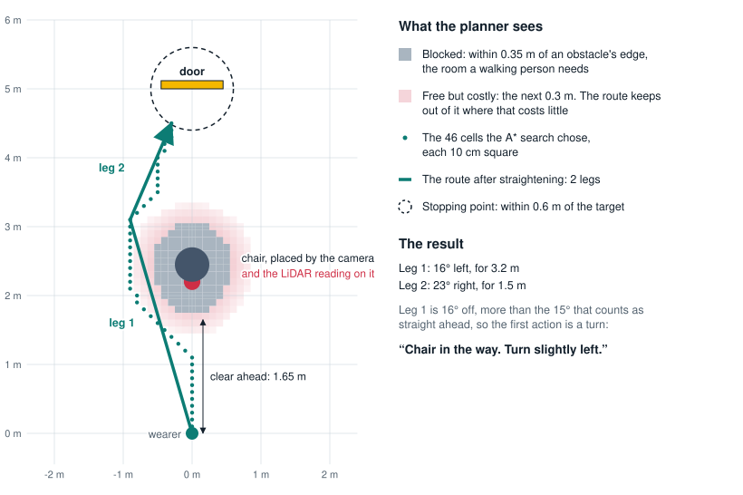

*The map and the route for the demo's "chair in the way" room, drawn from
the planner's own grid. The dotted line is what the search found; the
solid line is the same route after straightening.*

The result is a `Route`:

| Field | Meaning |
|---|---|
| `legs` | The stretches to walk, each a bearing and a length. Empty means no way forward |
| `reaches_goal` | Whether the route ends at the target |
| `clear_ahead` | Metres that are free straight ahead of the wearer |
| `direct` | Whether the straight line to the target is free |
| `blocker` | The name of what blocks that line, if the camera named it |

`clear_ahead` does count the target's own surface, with a clearance of
0.15 m: the route may end beside the target, but nobody is to be walked
into it.

### 8.4 Choosing the next action

`next_instruction()` turns the route into exactly one action:

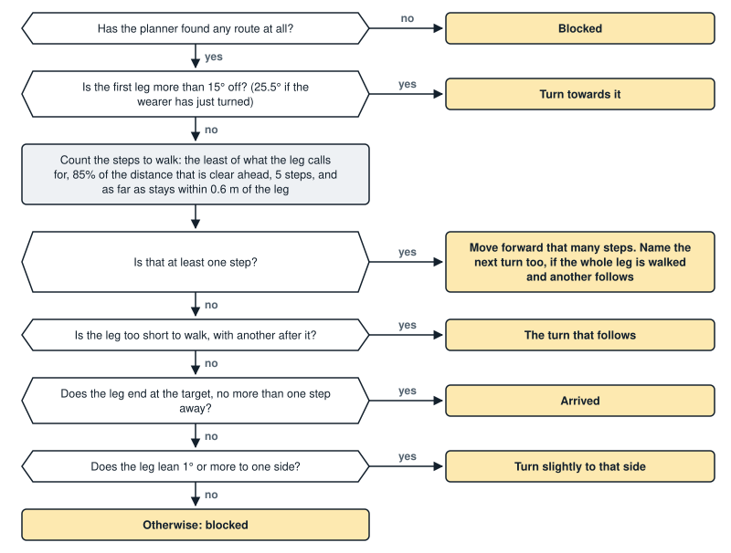

*Choosing the action. A pointed box is a question; a box on the right is
the action that answer leads to.*

The same rules in words:

1. **Turn first.** If the first leg is more than 15° off, the action is a
   turn, and nothing else.
2. **Then walk.** The number of steps is the smallest of:
   - what the leg calls for (its length divided by the 0.6 m step);
   - what there is room for: 85% of `clear_ahead`;
   - five steps;
   - as far as can be walked before drifting 0.6 m sideways from the leg,
     since the wearer walks the way they face, not exactly along the leg.
3. **Mention the next turn** ("Move forward 4 steps, then turn right") only
   if the whole leg is being walked and another follows.

   If no whole step can be taken, one of these applies instead:

4. **Skip a leg too short to walk** and go straight to the turn that
   follows it.
5. **Arrived**, if this leg ends at the target and is no longer than one
   step.
6. **Edge away.** If there is no room for a step although the wearer
   faces almost the right way, they are brushing past something: turn
   slightly to the side the route leans.
7. **Blocked** if none of these applies.

An `Instruction` has a kind (`turn`, `move`, `arrived`, `blocked`), a turn
name, a number of steps, and optionally a turn to make after walking.

### 8.5 Turns

A spoken turn comes in three sizes. People told to turn "slightly" turn
about 30°, and told to "turn" about 90°, so the sizes are chosen around
those.

| Angle to turn | Spoken | The wearer is expected to turn |
|---|---|---|
| up to 15° | nothing: it is straight ahead | 0° |
| up to 60° | "Turn slightly left / right" | 30° |
| up to 135° | "Turn left / right" | 90° |
| more | "Turn around" | 180° |

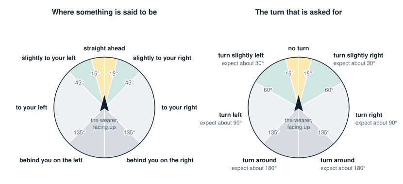

*The words for where something is (left) change at different angles from
the turn that is asked for (right). Something 50° to the right is "to your
right", but the turn towards it is still "slightly right", because a
slight turn of about 30° leaves less to correct than a full turn of 90°.*

Nobody turns exactly 30°. Right after a turn, the "straight ahead" band is
therefore widened by a factor of 1.7 (to 25.5°), so that the small error
left over is walked off rather than corrected with turn after turn.

### 8.6 Keeping the wearer steady

Imprecise turns and steps are expected, and several rules stop them from
causing trouble:

- **No walk longer than what was just measured as clear**, less a 15%
  margin, and never more than five steps.
- **No ping-pong between two routes.** Two ways round an obstacle are
  often nearly the same length, and which is shorter can change with every
  sweep. If the wearer has just been turned one way and the new plan would
  turn them back, the route is planned again with a preference for walking
  straight ahead (`keep_straight`), accepting up to 0.5 m more length.
- **The target behind the wearer.** A detour can turn the wearer's back on
  the target, further round than the head can look. For up to two cycles
  the assistant carries on from where the target must be.
- **Giving up, aloud.** Guidance ends with "I cannot find a clear way to
  the door. Guidance stopped." when the way has been blocked three times
  running, when the wearer has been turned through a full circle without a
  walk, or when ten instructions have brought the target no nearer (by at
  least 0.3 m). It ends with "I lost sight of the door. Guidance stopped."
  after three looks without it.

### 8.7 Timing

After an instruction the assistant waits before planning again
(`_time_for`):

| Instruction | Wait |
|---|---|
| A turn | 3 s |
| Blocked, or "forward slowly" | 4 s |
| A walk | 2 s, plus the steps at the wearer's own pace, plus 1.5 s if a turn follows; at most 12 s |

The pace is the step length divided by the wearer's usual walking speed,
which is learned (section 9). Meanwhile the main loop keeps watching. A
pause by the wearer brings the next cycle forward at once, and an obstacle
warning brings it forward to within a second.

### 8.8 Arrival

The aim is to stop `arrive_m` (0.6 m, arm's reach) from the target. Steps
are whole, so the wearer has arrived once less than half a step short of
that: at 0.9 m with the default settings. Between cycles, arrival is also
noticed directly when the target is on the camera's axis and that close, or
when no distance is known and the target has grown to fill the picture.

On arrival the trip is counted in the profile, so that a destination walked
to three times gets brief guidance from then on.

### 8.9 Without a LiDAR or a turning head

No route can be planned. Guidance then steers straight at the target by
camera, every picture (`_direct_instruction`): turn until it is ahead,
then walk towards it. This is what happens on a laptop and in the demo
page's camera section.

### 8.10 A worked example

One whole trip, recorded from the simulator: a chair stands 2.2 m in front
of the wearer, directly between them and a door 5 m away. The simulated
wearer does exactly what is said.

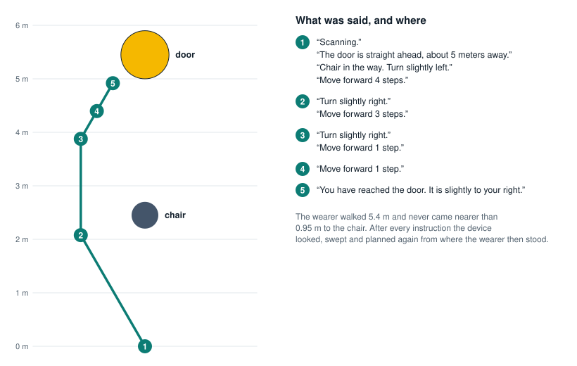

*The path walked, and what was said at each numbered place. This is the
trip the demo page plays in its first section.*

Three things in it are typical:

- The first route leaned 16° left, but the wearer was told "slightly left"
  and turned 30°. The next plan started from where they then stood and
  faced, and simply carried on from there.
- Walks are short: 4 steps, then 3, then 1 and 1. Each is limited by what
  the sweep had just measured as clear.
- The trip ends beside the door, not in front of it, because the route
  came round the chair. The last sentence says which way the door is.

---

## 9. Feedback and adaptation

Source: [`visual_assist/adaptation.py`](../visual_assist/adaptation.py).

The device has no motion sensor. The wearer's movement is read from what
it has (`MotionTracker`):

| What | Read from | Details |
|---|---|---|
| Walking speed | How fast the LiDAR distance ahead shrinks | Smoothed by half each reading. A change faster than 2.5 m/s is taken to be the beam jumping to another object and is ignored |
| Turning | How far the picture slides sideways between two pictures | Phase correlation on 160 × 120 grey copies; more than 8° counts as turning. No speed is measured while turning |
| Standing still | Neither of the above changing | Speed under 0.15 m/s, or under 3% of the picture changing |
| A pause | Standing still for 6 s after having moved | Counted once per stop |

### 9.1 Rules

| The assistant notices | and responds by |
|---|---|
| Walking speed | Warning further ahead: `1.0 m + speed × 1.5 s`, between 0.5 m and 3.0 m. At 1 m/s that is 2.5 m |
| An obstacle less than 1.5 s of walking away | "Stop, chair ahead, 1.1 meters", cutting in on anything being said. Repeated at most every 1.5 s |
| Walking fast, or a crowd | Shorter gaps between warnings: 4 s divided by `1 + speed`, halved in a crowd |
| Standing before the same obstacle | Not repeating the warning for 15 s unless the distance changes by 0.3 m |
| A pause during guidance | Repeating the instruction |
| Two pauses within two minutes | Detailed speech, and a description of what is ahead at each pause (at most every 30 s) |
| Three or more people in view | Saying once a minute at most that it is crowded, keeping warnings short, and not announcing strangers |
| A target guided to three times | Brief guidance: "3 steps." |
| A person met three times | Announcing them by name only, and before less familiar people |
| A person not met for a day or more | Adding how many days it has been |
| The wearer's usual walking pace | Timing the wait after "move forward" to match; learned 5% at a time |

How much is said (`verbosity`) is decided in this order: the wearer's
stated preference, then hesitation (detailed), then familiarity with the
target (brief), otherwise normal.

### 9.2 Deciding whether to warn

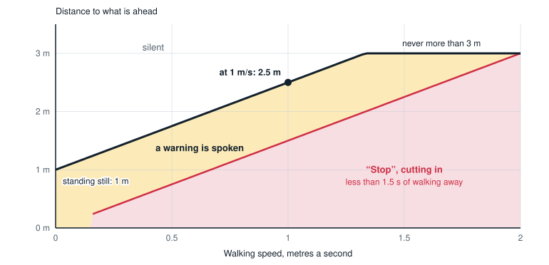

*How far ahead a warning is given, against walking speed, with the default
settings. Computed by `warn_distance()` and `is_urgent()`.*

Being inside the warning distance is not enough for a warning to be
spoken. `_warn_obstacle()` runs on every picture and decides:


The thing ahead is named from the detection on the camera's axis; if there
is none it is called an obstacle.

### 9.3 The profile

`UserProfile` is saved as JSON at `data/profile.json` whenever it changes.

| Field | Meaning | Changed by |
|---|---|---|
| `language` | Spoken language | "Speak in Malayalam" |
| `verbosity` | brief or detailed; empty means decide automatically | "Speak less", "More detail", "Normal detail" |
| `speech_rate` | Words per minute, 100 to 260 | "Speak faster / slower", 25 at a time |
| `warn_offset_m` | Added to the warning distance, −0.5 to 1.5 | "Warn me earlier / later", 0.25 m at a time |
| `walk_speed` | Usual walking speed, m/s | Learned while walking |
| `targets` | Times guided to each kind of object | Each arrival |
| `people` | For each person: meetings and when last seen | Each announcement |

A profile file that cannot be read is ignored with a warning.

---

## 10. Banknotes and faces

### 10.1 Banknotes

Source: [`visual_assist/currency.py`](../visual_assist/currency.py).

The model is an image classifier with 11 classes: `10_new`, `10_old`, `20`,
`50_new`, `50_old`, `100_new`, `100_old`, `200`, `500`, `2000` and `none`.
Old and new series look different, so they are separate classes; only the
value is spoken.

"What note is this?" takes three pictures and averages the model's scores,
so one blurred picture cannot decide the answer. `decide()` then adds the
scores of the series of the same value (55% `100_new` plus 35% `100_old` is
a confident 100) and takes the highest.

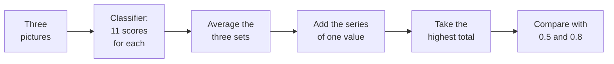

| Confidence | Answer |
|---|---|
| 0.8 or more | "This is a 500 rupee note." |
| 0.5 to 0.8 | "This looks like a 500 rupee note, but I am not sure. Please show it again." |
| below 0.5, or the `none` class | "I do not see a currency note. Hold it closer to the camera." |

The threshold for a plain statement is set high on purpose: a confident
mistake about money is the costly kind.

### 10.2 Faces

Source: [`visual_assist/faces.py`](../visual_assist/faces.py).

Two models from OpenCV's model zoo do the work. Both run on the OpenCV that
is already installed, so nothing has to be compiled on the device.

| Model | File in `weights/` | Job |
|---|---|---|
| YuNet | `face_detection_yunet_2023mar.onnx` (0.2 MB) | Finds the faces in a picture, with five landmarks on each: the eyes, the nose, the corners of the mouth |
| SFace | `face_recognition_sface_2021dec.onnx` (39 MB) | Turns one face, straightened by its landmarks to 112 × 112 pixels, into 128 numbers: its *feature* |

Pictures of the same person give features that point nearly the same way.
How nearly is their **similarity**: the cosine of the angle between them,
1 for identical and about 0 for unrelated faces.

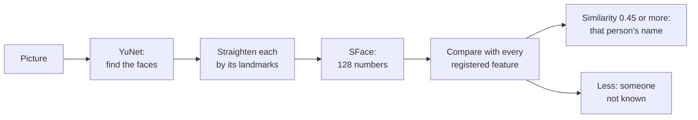

**Recognising.** A face is given the name of the registered person whose
feature it is most like, provided the similarity is at least
`faces.similarity` (0.45). Otherwise it is "a person I do not know". At most
the five largest faces in a picture are looked at, and faces narrower than
`faces.min_face_px` (40 pixels, about two metres away) are left out: too
few pixels to tell one person from another.

- Every third picture is checked. Each person is announced at most once
  every 20 seconds, the most often met first.
- An unknown face gets "There is a person I do not know. Say register face
  to remember them.", at most once every 20 seconds and not in a crowd.

**Registering.** "Register face" or "Remember this person as Ashna" stores
the feature of the largest face in view. The face must be at least twice
`min_face_px` wide (within about a metre), so that the stored likeness is a
good one; up to five pictures are tried. If no name was given the assistant
asks for one and waits up to 15 seconds. `python main.py register NAME`
does the same from the command line. Registering someone again adds another
view of them, which helps them be recognised from more angles; the eight
most recent views are kept.

**What is stored.** Only the features, in `data/faces/faces.json`, with the
name of the model that made them. Photos are never kept and nothing leaves
the device. A file made by a different model is ignored with a warning,
since its numbers cannot be compared with these.

**Choosing the threshold.** On 352 faces from 292 unrelated photos, 0.05%
of the pairs of faces from different photos scored 0.45 or more (0.34% at
OpenCV's suggested 0.363). In a handful of photos of the same person the
similarity was 0.75 to 0.98. The stricter 0.45 was chosen because, for a
blind wearer, a wrong name is worse than "a person I do not know". Lower it
if known people often go unrecognised; raise it if strangers are named.

If the model files are missing and cannot be downloaded, or OpenCV is older
than 4.8, face recognition is switched off with a warning and everything
else carries on.

---

## 11. Speech in and out, and languages

### 11.1 Speech out

Source: [`visual_assist/speech.py`](../visual_assist/speech.py).

| Voice | What | Needs |
|---|---|---|
| offline | `espeak-ng` on the Pi, the built-in Windows voices on a PC | nothing |
| gtts | Google Text-to-Speech, natural voices in all four languages | internet; `mpg123` on the Pi |
| console | Print only | nothing |

With `speech.backend: auto`, English uses the offline voice and the other
languages use Google's. Whatever is chosen, the offline voice stands behind
it: if a voice fails (usually no internet) the next one speaks the sentence
and the failed one is left alone for 60 seconds. A dropped connection never
means silence.

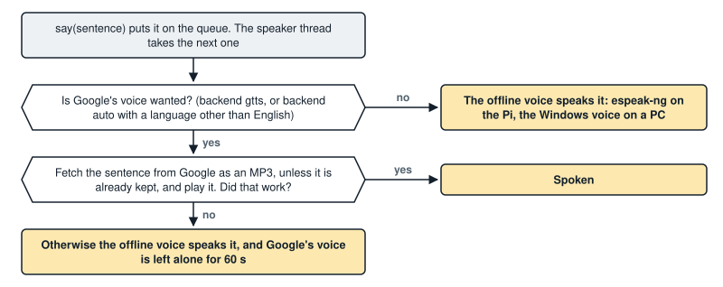

`Speaker.say(text)` puts the sentence on a queue served by a worker
thread. With `urgent=True` the queue is emptied and the sentence being
spoken is cut off. Each Google sentence is fetched once and kept as an MP3
in the system's temporary folder, since phrases such as "Scanning" repeat.
Every sentence is also printed as `[TTS]: ...`.

### 11.2 Speech in

Source: [`visual_assist/listener.py`](../visual_assist/listener.py).

| Backend | What | Needs |
|---|---|---|
| vosk | Offline recognition, 16 kHz mono | A Vosk model in `models/` |
| google | Google Speech Recognition, language `en-IN` | internet |
| keyboard | Typed commands | nothing |

With `listener.backend: auto`, Vosk is tried, then Google, then the
keyboard. Each backend has one method, `listen()`, which returns the text
heard within `listener.timeout_s` (6 s) or nothing.

### 11.3 Languages

Source: [`visual_assist/phrases.py`](../visual_assist/phrases.py) and
[`visual_assist/locales/`](../visual_assist/locales/).

Every sentence the assistant can say is stored per language in
`locales/<code>.json`, so sentences can be corrected or translated without
touching code. A file has three parts:

| Part | Content |
|---|---|
| `name` | The language's name |
| `phrases` | 87 sentences and fragments, with `{placeholders}` |
| `labels` | Object names in that language, with the grammar they need |

A phrase is normally one string. Two kinds have variants:

- **By count**: `{"one": "move forward 1 step", "other": "move forward {n} steps"}`.
- **By the grammatical form of the object named**: `{"default": ..., "f": ...}`.
  Hindi verbs agree with the gender of the object, and Tamil uses a
  different verb for people than for things. A label declares its form,
  and the form used before a postposition, as
  `{"text": ..., "form": ..., "obl": ...}`.

A phrase or label missing from a language falls back to English.

The Malayalam, Hindi and Tamil sentences were written by a non-native
speaker and should be read through by a native speaker before real use.

---

## 12. Configuration reference

All settings live in [`config.yaml`](../config.yaml). Every key is
optional; the defaults are in [`config.py`](../visual_assist/config.py). An
unknown key is an error, so a typing mistake is caught at start-up. Paths
are relative to the folder holding the config file. `auto` means: use the
real device if it is there, otherwise carry on without it.

### `camera`

| Key | Default | Meaning |
|---|---|---|
| `backend` | `auto` | `auto`, `picamera2` or `opencv` |
| `index` | 0 | Webcam number when the Pi Camera is not used |
| `width`, `height` | 640, 480 | Picture size |
| `hfov_deg`, `vfov_deg` | 62.2, 48.8 | Field of view (Pi Camera Module V2). Wrong values give wrong bearings and distances |

### `detector`

| Key | Default | Meaning |
|---|---|---|
| `weights` | `weights/yolov5nu.pt` | The main model |
| `confidence` | 0.35 | Detections below this are dropped |
| `imgsz` | 640 | Model input size |
| `aliases` | couch to sofa, and others | Model class name to spoken name |
| `extra` | the door model | More models. Each entry has `weights` and optionally `classes` (keep only these), `confidence`, `imgsz`, `aliases` |

### `lidar`

| Key | Default | Meaning |
|---|---|---|
| `backend` | `auto` | `auto`, `tfluna` or `none` |
| `port` | `/dev/serial0` | Serial port |
| `baudrate` | 115200 | |

### `servo`

| Key | Default | Meaning |
|---|---|---|
| `backend` | `auto` | `auto`, `esp8266`, `gpio` or `none` |
| `port` | `/dev/ttyUSB0` | The ESP8266's serial port |
| `baudrate` | 115200 | |
| `pan_pin`, `tilt_pin` | 12, 13 | BCM pins, `gpio` backend only |
| `pan_center`, `tilt_center` | 90, 90 | Servo angle for straight ahead and level |
| `pan_invert` | false | Set true if "right" turns the head left |
| `scan_angles` | −60, −30, 0, 30, 60 | Where the head looks during a scan |
| `settle_s` | 0.4 | Wait after a move before using the camera |

### `speech`

| Key | Default | Meaning |
|---|---|---|
| `backend` | `auto` | `auto`, `offline`, `gtts` or `console` |
| `language` | `en` | `en`, `ml`, `hi` or `ta` |
| `rate` | 160 | Words per minute (offline voice) |

### `listener`

| Key | Default | Meaning |
|---|---|---|
| `backend` | `auto` | `auto`, `vosk`, `google`, `keyboard` or `none` |
| `vosk_model` | `models/vosk-model-small-en-us-0.15` | Folder of the Vosk model |
| `language` | `en-IN` | For the Google backend |
| `wake_word` | empty | If set, only phrases containing it are obeyed |
| `timeout_s` | 6 | How long one `listen()` waits |

### `faces`

| Key | Default | Meaning |
|---|---|---|
| `enabled` | true | |
| `dir` | `data/faces` | Where the registered faces are kept |
| `detector` | `weights/face_detection_yunet_2023mar.onnx` | The model that finds faces; downloaded on first use |
| `recogniser` | `weights/face_recognition_sface_2021dec.onnx` | The model that tells faces apart; downloaded on first use |
| `similarity` | 0.45 | Least likeness (0 to 1) for a face to be given a name. Higher is stricter |
| `min_face_px` | 40 | Faces narrower than this are ignored; twice this is needed to register |
| `every_n_frames` | 3 | Check every n-th picture |
| `announce_cooldown_s` | 20 | Least time between announcing the same person |

### `navigation`

| Key | Default | Meaning |
|---|---|---|
| `step_length_m` | 0.6 | The wearer's step; guidance counts in these |
| `obstacle_warn_m` | 1.0 | Warning distance when standing still |
| `arrive_m` | 0.6 | Stop this far from the target |
| `warn_cooldown_s` | 4 | Least time between obstacle warnings |
| `center_deadband_deg` | 15 | Within this angle the target is "straight ahead". Must be at least half of a slight turn (about 30°), or guidance swings from side to side |
| `lost_frames` | 3 | Looks without the target before guidance stops |

### `planner`

| Key | Default | Meaning |
|---|---|---|
| `enabled` | true | Needs a LiDAR and a turning head |
| `sweep_half_angle_deg` | 72 | How far the sweep goes to each side |
| `sweep_step_deg` | 6 | Angle between readings |
| `sweep_settle_s` | 0.05 | Wait at each step of the sweep |
| `clearance_m` | 0.35 | Room kept between the wearer and obstacles |
| `resolution_m` | 0.1 | Map cell size |
| `max_range_m` | 6.0 | LiDAR hits beyond this are ignored |

### `adaptation`

| Key | Default | Meaning |
|---|---|---|
| `enabled` | true | |
| `profile` | `data/profile.json` | Where the user profile is kept |
| `reaction_s` | 1.5 | Warn this many seconds of walking ahead |
| `max_warn_m` | 3.0 | Longest warning distance |
| `walk_speed_mps` | 0.8 | Starting guess of the walking speed |
| `pause_s` | 6 | Standing still this long is a pause |
| `pause_window_s` | 120 | Pauses within this time are counted together |
| `hesitant_pauses` | 2 | Pauses in the window before speech turns detailed |
| `describe_cooldown_s` | 30 | Least time between descriptions on pausing |
| `crowded_people` | 3 | People in view that make a place crowded |
| `familiar_after` | 3 | Trips to a target before guidance turns brief |

### `currency`

| Key | Default | Meaning |
|---|---|---|
| `weights` | `weights/currency.pt` | The banknote model; empty switches the feature off |
| `confidence` | 0.8 | Below this the answer is given as a guess |
| `minimum` | 0.5 | Below this it is treated as no note |

### Constants in the code

These are not settings, but they shape the behaviour described above.

| Constant | Value | Where | Meaning |
|---|---|---|---|
| `AGREEMENT` | 1.5 | `navigator` | LiDAR and camera must agree within this factor |
| `SLIGHT_TURN_DEG` | 60 | `navigator` | Largest turn spoken as "slightly" |
| `AFTER_TURN_SLACK` | 1.7 | `navigator` | Widening of "straight ahead" right after a turn |
| `STEP_MARGIN` | 0.85 | `navigator` | Share of the clear distance that may be walked |
| `MAX_STEPS` | 5 | `navigator` | Longest walk in one instruction |
| `MAX_DRIFT_M` | 0.6 | `navigator` | Most a walk may stray sideways from its leg |
| `SOFT_MARGIN_M`, `SOFT_PENALTY` | 0.3, 2.0 | `planner` | Extra room taken when it costs little |
| `TARGET_CLEARANCE_M` | 0.15 | `planner` | How near the target's surface a walk may end |
| `STRAIGHT_BONUS_M` | 0.5 | `planner` | Extra length accepted to keep going straight |
| `MAX_EXPANSIONS` | 40,000 | `planner` | Limit on the search |
| `MAX_STALLED` | 10 | `assistant` | Instructions without progress before giving up |
| `SAME_OBJECT_DEG` | 15 | `assistant` | Sightings this close in direction are one object |

---

## 13. Models and training

| File | Kind | Classes | Base | Trained on |
|---|---|---|---|---|
| `weights/yolov5nu.pt` | Detector | 80 (COCO) | | By Ultralytics; downloaded on first run |
| `weights/doors.pt` | Detector | door (and handle, cabinet door, refrigerator door, which are dropped) | `yolov5nu.pt` | DoorDetect and Open Images |
| `weights/currency.pt` | Classifier | 10 kinds of note and "none" | `yolov8n-cls.pt` | Mendeley Indian banknote dataset, plus Open Images and door photos for "none" |
| `weights/face_detection_yunet_2023mar.onnx` | Face detector | faces, with five landmarks | | By OpenCV's model zoo; downloaded on first use |
| `weights/face_recognition_sface_2021dec.onnx` | Face recogniser | a 128-number feature | | By OpenCV's model zoo; downloaded on first use |

From the public datasets to the models the device and the demo page use:

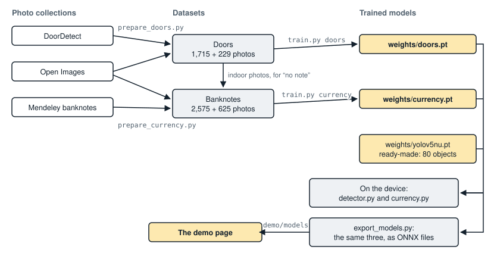

### 13.1 Training

Scripts: [`training/`](../training/).

```bash
pip install ultralytics pillow
python training/prepare_doors.py       # downloads about 700 MB, builds the dataset
python training/train.py doors         # about 1.5 hours on a laptop CPU
python training/prepare_currency.py    # downloads about 750 MB
python training/train.py currency      # about ten minutes
```

| Preset | Image size | Epochs | Batch | Frozen layers | Notes |
|---|---|---|---|---|---|
| `doors` | 512 | 30 | 16 | 10 (the backbone) | Sized for a CPU |
| `currency` | 256 | 6 | 32 | 0 | Also trains on upside-down notes |
| `custom` | 640 | 100 | 16 | 0 | Your own dataset, see `training/dataset.yaml` |

Any option given after the preset name overrides it. With a GPU, train the
whole door network for longer:

```bash
python training/train.py doors --imgsz 640 --epochs 100 --freeze 0
```

Training stops early after 10 epochs without improvement, copies the best
weights to `weights/<name>.pt`, and prints the scores on the validation
photos.

**Datasets**

| Dataset | Use | Size |
|---|---|---|
| Doors | DoorDetect (indoor photos) merged with every Open Images validation and test photo that has a "Door" box; shrunk to 640 px; 12% held out | 1,715 training photos with 1,451 labelled doors; 229 held out |
| Banknotes | One folder per class; shrunk to 512 px; 20% held out. The "none" class is Open Images photos with large faces and hands, other everyday photos, and indoor photos from the door set | 2,575 training photos; 625 held out (400 notes, 225 "none") |

The "none" class matters as much as the notes. A camera held by a person
mostly sees that person. An earlier version of the model, with a thinner
"none" class, called a face a ₹10 note.

### 13.2 Measured accuracy

All figures are on photos the models never saw during training.

**Door model** (strict score: AP50 0.45). Judged the way the assistant uses
it, at the confidence set in `config.yaml`:

| | Indoor photos (136) | All photos (229) |
|---|---|---|
| When it reports a door, it is right | 69% (38 of 55) | 71% (102 of 143) |
| Doors found | 64% (39 of 61) | 54% (98 of 181) |
| Large doors found (at least 8% of the picture) | 85% (17 of 20) | 67% (53 of 79) |
| Photos with a false door | 15 of 136 | 32 of 229 |

This is enough for a prototype but not reliable: small, distant or
half-hidden doors are often missed, and about one photo in nine shows a
false door. The assistant allows for it by scanning from five angles and
trusting the most confident sighting. The model was trained on a laptop CPU
with most of the network frozen; full training on a GPU should do better.

**Banknote model**

| Held-out photos | Result |
|---|---|
| 400 banknotes | 390 named correctly and stated plainly |
| | 9 named correctly, offered as a guess |
| | 1 named wrongly, offered as a guess |
| | 0 named wrongly and stated plainly; 0 missed |
| 225 photos with no banknote | 225 correctly reported as no note |

The banknote photos come from the same collection as the training photos
(same notes, same camera), so expect lower accuracy on a live camera. It
has not been tried with real notes.

### 13.3 Models for the browser

[`demo/export_models.py`](../demo/export_models.py) converts the three
trained models to ONNX (opset 17) into `demo/models/`, copies the two face
models there (they are ONNX files already), and writes `models.json` with
each model's input size, thresholds and class names, all taken from
`config.yaml`. The demo page therefore detects with the same settings as
the device. Run it again after retraining a model or changing those
settings; a test fails while they disagree. A model that has not changed
since it was last converted is left alone.

### 13.4 Data sources

- **DoorDetect.** M. Arduengo, C. Torras, L. Sentis, "Robust and adaptive
  door operation with a mobile robot", *Intelligent Service Robotics*, 2021.
  <https://github.com/MiguelARD/DoorDetect-Dataset>
- **Open Images V7.** Google; images CC BY 2.0, annotations CC BY 4.0.
  <https://storage.googleapis.com/openimages/web/index.html>
- **Dataset of Indian (Rupees) and Thai (Baht) Banknotes with
  Annotations.** V. Meshram, K. Patil, P. Chumchu, Mendeley Data, 2021,
  CC BY 4.0. <https://data.mendeley.com/datasets/2kfz5yc7pt/1>

---

## 14. Simulation

Source: [`visual_assist/simulation.py`](../visual_assist/simulation.py).

The simulator lets the whole assistant run with no hardware. It is what the
tests, `python main.py simulate` and the demo page use.

**The world.** The floor is a plane seen from above. Everything solid is a
disc: labelled things (`{"door": (x, y, radius)}`) and anonymous blocks. A
wall is a row of small discs. The `World` also holds the wearer's position
and heading, where the head points, the path walked, and the closest the
wearer has come to anything.

**The stand-in devices**

| Stand-in | Behaviour |
|---|---|
| `FakeCamera` | Returns a placeholder picture |
| `FakeDetector` | Reports every labelled thing inside the field of view, with the box a real object of that size would have. It ignores what is hidden behind something else |
| `FakeLidar` | The distance to the first disc along the beam, up to 8 m |
| `FakePanTilt` | Sets where the head points; `FixedPanTilt` is a head that cannot turn |
| `FakeSpeaker` | Collects what is said |
| `Clock` | Time that moves only when told to, so tests are instant and repeatable |

**The simulated wearer.** `World.obey(instruction)` does what was said.
Given a random source, it does so imprecisely: turns are off by up to a
third and steps by up to 15%.

**Entry points**

| Function | Use |
|---|---|
| `make(things, blocks, ...)` | An assistant in a simulated room: `(assistant, world, speaker, clock)` |
| `follow_guidance(assistant, world, clock)` | Keep obeying until guidance ends |
| `cluttered_room(rng)` | A door 3 m to 6 m away with up to five obstacles before it |
| `record(things, blocks, language)` | One guided trip as plain data, for the demo page to replay |
| `trace(scene)` | One command followed cable by cable, for the demo page's device section |
| `demonstrate(room, language, seed)` | What `python main.py simulate` runs |

**Wire-level simulation.** `trace()` does not use `FakeLidar` and
`FakePanTilt`. It uses the real drivers, `TFLuna` and `Esp8266PanTilt`,
connected to a simulated serial line each: `SimulatedUart` answers every
read with the frame a TF-Luna would send, and `SimulatedEsp8266` does what
the firmware does with each line of text. The text and bytes recorded are
therefore what the Raspberry Pi really sends and expects.

```bash
python main.py simulate                  # a chair between the wearer and the door
python main.py simulate --room opening   # a wall with one opening
python main.py simulate --seed 5         # a random cluttered room
python main.py --language ml simulate    # the same, spoken in Malayalam
```

---

## 15. The demo page

Sources: [`index.html`](../index.html), [`demo/`](../demo/). Live at
<https://saravanakumart362-create.github.io/Visual-assist/>.

The page is static: plain files served by GitHub Pages, with no server of
its own. It has three demonstrations.

### 15.1 The three demonstrations

| Section | What the visitor does | What runs |
|---|---|---|
| **Ask for the door** | Drags a door and obstacles round a simulated room, picks a language, presses "Guide me to the door" | The project's own Python guidance code, in the browser |
| **Try it on your own camera** | Starts their camera and asks "What is around me?", "Where is the door?", "What note is this?", "Who is this?" by button, typing or voice; registers a face by name | The project's three models, and its assistant, in the browser |
| **Inside the device** | Steps through a command and sees what each part sends to the next | Two recorded commands, and a live one that follows whatever was last asked of the camera |

### 15.2 How Python and the models run in a browser

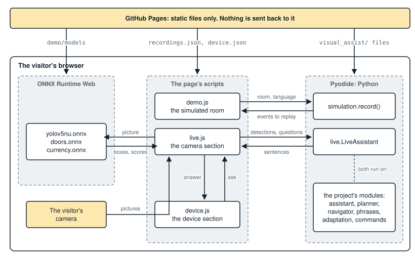

*What runs where. Nothing is sent back to the server: once the files are
loaded, everything happens in the visitor's browser.*

- **Python.** [Pyodide](https://pyodide.org) (version 0.26.4) is a Python
  interpreter compiled for browsers. `demo/demo.js` fetches a fixed list of
  the project's own files from `visual_assist/` and runs them unchanged. A
  test checks that this list is enough.
- **Models.** [ONNX Runtime Web](https://onnxruntime.ai) (version 1.19.2)
  runs the models in a worker, so the page stays responsive. The first
  start downloads about 40 MB; the two face models (39 MB) are fetched only
  when someone first asks about a face.
- **Speech.** The browser's own speech synthesis speaks the answers, and
  in Chrome and Edge its speech recognition takes spoken questions.
- **Privacy.** The camera picture never leaves the visitor's device.

### 15.3 Files

| File | Role |
|---|---|
| `index.html` | The page, including the diagram of the device as inline SVG |
| `demo/demo.css` | Styling, light and dark |
| `demo/demo.js` | The simulated room; loads Pyodide and the project's Python |
| `demo/live.js` | The camera section: detection, the banknote model, the assistant |
| `demo/device.js` | The device section: lights parts, moves a dot along cables, lists what was sent |
| `demo/recordings.json` | The two preset rooms and one recorded trip through each |
| `demo/device.json` | The two recorded commands of the device section |
| `demo/models/` | The ONNX models and `models.json` |
| `demo/make_recordings.py` | Writes the two JSON files and stamps the page's links |
| `demo/export_models.py` | Converts the models (section 13.3) |
| `.nojekyll` | Must stay: without it GitHub Pages hides `visual_assist/__init__.py` |

### 15.4 The simulated room

The preset rooms play at once from `recordings.json`, even where Pyodide
cannot load. Any other room, or any other language, is planned on the spot:
the page calls `simulation.record()` in the browser's Python and replays
the events it returns.

| Event | Content |
|---|---|
| `say` | Who spoke (`user` or `assistant`) and the text |
| `look` | The head turns to this angle |
| `photo` | The camera takes a picture |
| `ray` | One LiDAR reading: bearing and distance |
| `route` | The planned route as points |
| `turn` | The wearer turns to this heading |
| `walk` | The wearer walks to this point |

### 15.5 The camera section

Each cycle the page draws the camera picture into each model's input size,
runs the two detection models, and hands the results to
`visual_assist.live.LiveAssistant` as JSON. That class presents them to the
ordinary `Assistant` as the camera and detector it expects, with no LiDAR
and no turning head. What is then decided and said is the same code that
runs on the device.

| `LiveAssistant` method | Purpose |
|---|---|
| `see(picture)` | One analysed picture; runs one step of the assistant |
| `hear(text)` | A question, answered on the next picture. Returns what it was taken to be |
| `intent(text)`, `command(text)` | What the command parser makes of a question |
| `view()` | The current picture as the assistant sees it: each object's place, bearing and estimated distance |
| `note(scores)` | The banknote model's scores |
| `use_faces(on)` | Says whether the page has its face models loaded |
| `people()` | The faces in the current picture: each one's box, name if known, and likeness |
| `set_language(code)`, `greet()`, `camera_off()` | As named |
| `guiding` | The object being guided to, if any |

Because there is no LiDAR, distances are camera estimates ("about 2
meters"), and there is no route planning.

**Faces on the page.** The page runs the same two face models as the device
(section 10.2). OpenCV is not there to do the steps between them, so
`live.js` does: it puts the picture in the top left of a black 640 × 640
square for the detector, reads the detector's three grids of answers into
boxes and landmarks, keeps the surest of any that overlap, and draws each
face turned, scaled and shifted so that its landmarks land where the
recogniser expects them. A prototype of exactly these steps gave the same
boxes and landmarks as OpenCV, and features matching OpenCV's to four
decimal places.

The boxes and features go to Python with each picture, and from there on
the code is the device's own: the same `FaceBook` and `People` match them
against the registered faces with the same threshold. Three things differ:

- Registered faces are kept in the page's memory only, and are forgotten
  when the page is closed or reloaded.
- The device waits up to 15 seconds for a name after "Register face". A
  page cannot wait without freezing, so `LiveAssistant` asks the question
  and takes the name from the next phrase.
- The face models load on the first question about a face, not at the
  start.

### 15.6 The device section

A diagram shows every part and the cable joining it to the Raspberry Pi.
For each step of a command, `device.js` lights the parts at work, moves a
dot along the cables in use, and lists what was sent.

Each step in `device.json` has a kind:

| Kind | Shows |
|---|---|
| `hear`, `understand`, `speak` | The words heard, the command they became, a sentence spoken |
| `turn` | The lines of text sent to the ESP8266, its replies, the pulse given to each servo |
| `see` | What the detector named in one picture |
| `measure` | The LiDAR's 9 bytes and what they mean |
| `look` | Turn, see and measure together, for the later views |
| `aim` | The head turned to an object, the LiDAR reading, the camera's estimate, and which was used |
| `centre` | The head returning to straight ahead |
| `sweep` | The 25 readings of a sweep |
| `plan` | The obstacles given to the planner, and the route found |

The third choice, **Your camera, live**, is not a recording. When a
question is answered in the camera section, `live.js` reports the steps it
really went through, with the picture taken, what was found in it and the
sentence built. The parts a phone or laptop lacks (LiDAR, ESP8266, servos)
are shown faded. The two sections talk only through three events on the
document:

| Event | Sent by | Meaning |
|---|---|---|
| `visualassist:camera` | `live.js` | The camera started or stopped |
| `visualassist:answer` | `live.js` | A question was answered; carries its steps |
| `visualassist:ask` | `device.js` | Ask this question |

### 15.7 Keeping the page current

```bash
python demo/make_recordings.py
```

Run this after changing the guidance code, the style sheet or a script. It
rewrites both JSON files and renews the `?v=` code on each link to a style
sheet or script in `index.html`. The code is made from the file's
contents, so a browser that kept an old copy sees a new address and
fetches the new file. The tests fail while anything here is out of date.

### 15.8 Publishing and previewing

**GitHub Pages.** In the repository open *Settings*, then *Pages*; choose
*Deploy from a branch*, branch `main`, folder `/ (root)`.

**On your own PC**

```bash
python -m http.server 8000      # then open http://localhost:8000/
```

Opening `index.html` by double-clicking does not work, because browsers do
not let a page read other files straight from the disk.

---

## 16. Tests

```bash
python -m pytest
```

176 tests, about seven seconds, no hardware needed.

| File | Tests | Covers |
|---|---|---|
| `tests/test_core.py` | 25 | Settings, command parsing, LiDAR frames, the LiDAR and servo drivers on a fake serial line, bearings and turns, distance from size, combining LiDAR and camera, banknote decisions |
| `tests/test_planner.py` | 17 | Routes on open floor, round an obstacle, through a gap in a wall, when walled in; joining LiDAR hits into walls; the rules for choosing an instruction |
| `tests/test_phrases.py` | 12 | Sentences in English; every language complete, with the same placeholders; grammatical forms |
| `tests/test_adaptation.py` | 19 | Speed from the LiDAR, pauses, warning distance, urgency, verbosity, the saved profile, crowds, familiar faces |
| `tests/test_assistant.py` | 22 | The whole assistant in simulated rooms: find, scan, distance, guidance with and without a planner, giving up, faces, banknotes, language, wake word |
| `tests/test_random_rooms.py` | 2 (4 runs) | 240 random cluttered rooms |
| `tests/test_faces.py` | 11 | Face matching and its threshold, the saved file, registering only a face that is close, several tries, doing without when the models are missing; and that the real models load |
| `tests/test_live.py` | 14 | The assistant fed by a web page: answers, upright phone pictures, banknotes, guidance by camera, faces found by the page, a name taken from the next phrase |
| `tests/test_demo.py` | 11 | Recordings match the current code; the page's Python file list is complete; page links are stamped; browser models match `config.yaml`; nothing the page needs is ignored by git |

**The random rooms.** 240 rooms are walked, half of them by a simulated
wearer whose turns are off by up to a third and whose steps by up to 15%.
Two promises are checked:

- **Safety is absolute.** In no room, however roughly the instructions are
  followed, does the wearer come within 10 cm of an obstacle or 5 cm of the
  door, and guidance always ends.
- **Success is statistical.** At least 95% of the rooms are solved by a
  wearer who follows exactly, and at least 90% by one who follows
  imprecisely. A room that is not solved must end with the assistant
  saying so.

---

## 17. Installing and running

### 17.1 On a PC, with or without a webcam

```bash
git clone https://github.com/saravanakumart362-create/Visual-assist.git
cd Visual-assist
pip install opencv-python ultralytics pyyaml pyserial gTTS pytest

python main.py simulate               # no hardware at all
python main.py check                  # which devices and libraries were found
python main.py --keyboard --show      # live on a webcam, typed commands
python -m pytest                      # the tests
```

### 17.2 On the Raspberry Pi

```bash
# 1. Enable the camera and the serial port (Interface Options ->
#    Serial Port: login shell NO, hardware port YES), then reboot.
sudo raspi-config

# 2. System packages
sudo apt update
sudo apt install -y python3-picamera2 python3-opencv espeak-ng mpg123 \
                    portaudio19-dev

# 3. Python packages (the venv must see the apt-installed picamera2)
python3 -m venv --system-site-packages venv
source venv/bin/activate
pip install -r requirements.txt

# 4. Offline speech recognition model
mkdir -p models && cd models
wget https://alphacephei.com/vosk/models/vosk-model-small-en-us-0.15.zip
unzip vosk-model-small-en-us-0.15.zip && cd ..
```

Copy the whole project folder to the Pi, including `weights/doors.pt` and
`weights/currency.pt`. The two face models (39 MB) are downloaded to
`weights/` the first time the assistant starts with an internet connection;
copy them from the PC as well if the Pi will have none. Flash the sketch in `firmware/esp8266_pan_tilt/` to
the ESP8266 with the Arduino IDE (board: *NodeMCU 1.0*), then plug it into
the Pi.

### 17.3 Command line

| Command | Effect |
|---|---|
| `python main.py` | Start the assistant |
| `python main.py check` | Try to open each part and report what was found. Run this first |
| `python main.py register NAME` | Register the face in front of the camera |
| `python main.py simulate [--room chair\|opening] [--seed N]` | Guide a simulated wearer |

| Option | Effect |
|---|---|
| `--config PATH` | Use another settings file |
| `--keyboard` | Type commands instead of speaking them |
| `--show` | Show the camera view with boxes |
| `--language en\|ml\|hi\|ta` | Language to speak |

Options go before the command: `python main.py --language ml simulate`.

### 17.4 First start on the hardware

Expect to adjust `config.yaml` when the hardware is first connected:

| Symptom | Setting |
|---|---|
| `check` reports no LiDAR or no pan-tilt | `lidar.port`, `servo.port` |
| "Turn right" guidance turns the head left | `servo.pan_invert: true` |
| The head does not face forward at rest | `servo.pan_center`, `servo.tilt_center` |
| Directions or camera distances are off | `camera.hfov_deg`, `camera.vfov_deg` |
| Other people's talk triggers commands | `listener.wake_word` |

### 17.5 Files written while running

| File | Content |
|---|---|
| `data/profile.json` | The user profile (section 9.3) |
| `data/faces/faces.json` | The registered faces (section 10.2) |
| The system's temporary folder, `visual_assist_tts/` | Cached speech from Google |

`data/` is not committed to git: it is personal.

---

## 18. What is verified, and known limits

**Verified on a PC**

- The test suite.
- Guidance in simulation: 997 of 1,000 random rooms reached; the other
  three ended with a spoken stop; nothing was ever touched.
- The door and banknote models on held-out photos (section 13.2).
- Speech synthesis in all four languages.
- A short live trial on a webcam with typed questions.
- Face registration and recognition, with saved photos standing in for the
  camera: a person registered from one photo was named in other photos of
  them, alone and beside someone else, and other people were not.
- The demo page in a headless browser, its camera section with saved
  photos standing in for the camera. That includes faces: a person
  registered there from one photo was named in other photos, and other
  people were not.

**Not verified**

- Anything on the Raspberry Pi itself: the Pi Camera, the TF-Luna, the
  servos and ESP8266, the microphone.
- The LiDAR and servo drivers against real hardware. They have been run
  only against the simulated LiDAR and ESP8266.
- Face recognition on a live camera, and how often it names people rightly
  in everyday light and at everyday angles.
- The demo page's camera section on a real camera or a phone, and its
  spoken questions and spoken answers.
- The Malayalam, Hindi and Tamil sentences, by a native speaker.

**Known limits**

- Route planning has been exercised only against simulated rooms. Real
  LiDAR readings are noisier, and a single beam at one height does not see
  obstacles above or below it. The white cane stays essential.
- The camera's distance estimate assumes ordinary sizes. Tables and sofas
  vary too much, so without the LiDAR their distance is not given.
- Walking speed is measured only while walking towards something within
  the LiDAR's 8 m.
- Voice commands are English only; the replies are multilingual.
- Banknote recognition expects the note held close to the camera, filling
  most of the picture, as in the training photos.
- The simulated detector does not model one object hiding another.

---

## 19. Relation to the project report

The report describes the system but does not include its source code, so
this is a new implementation of that description. Where the report is
silent or inconsistent, these choices were made:

| Topic | In the report | Here |
|---|---|---|
| LiDAR model | The text names both "TF-Luna" and "TF-LC02"; the code screenshot reads TF-Luna UART frames | TF-Luna over UART |
| LiDAR wiring | The circuit diagram labels the lines SDA/SCL (I²C); the code screenshot uses serial | UART wiring |
| Servo control | The text says the ESP8266 drives the servos; the circuit diagram wires them to the Pi | Both are supported (`servo.backend`) |
| Detection models | One custom model for doors, chairs and desks | The pretrained model for everyday objects and a separately trained one for doors, which keeps the pretrained model's accuracy |
| Face recognition | | OpenCV's YuNet and SFace models. The widely used `face_recognition` library must be compiled on each machine and would not install on the development PC |

The report also describes door detection, adaptation to the wearer,
banknote recognition, speech in several languages and shortest-path
routing around obstacles. All five are implemented here (sections 7 to 11).

---

## 20. Extending the project

**Recognise another kind of object.** Label photos in YOLO format (see
[`training/dataset.yaml`](../training/dataset.yaml)), then:

```bash
python training/train.py custom --data my.yaml --name indoor
```

Add `weights/indoor.pt` to `detector.extra` in `config.yaml`. If the
object's size varies little, add it to `TYPICAL_SIZE_M` in `navigator.py`
so the camera can estimate its distance. Add its name to the `labels` of
each locale file, and run `python demo/export_models.py` for the demo page.

**Add a language.** Copy `locales/en.json` to `locales/<code>.json` and
translate the right-hand sides, keeping the `{placeholders}`. Add the
language's English name to `LANGUAGES` in `phrases.py`. The tests check
that the new file is complete.

**Add a voice command.** Add a rule to `parse()` in `commands.py`, a
method `_cmd_<intent>` to `Assistant`, any new sentence to every locale
file, and a case to the parsing test in `tests/test_core.py`.

**Support another device.** Write a class with the same methods as the
one it replaces and return it from the module's `open_...()` function:

| Device | Methods |
|---|---|
| Camera | `read()` giving a BGR picture or nothing, `close()` |
| LiDAR | `read()` giving metres or nothing, `close()`, and `available` |
| Pan-tilt | `look(bearing, tilt, settle)`, `center()`, `close()`, and `can_move` |
| Listener | `listen()` giving text or nothing |
| Speaker | `say(text, wait, urgent)`, `wait()`, `configure(language, rate)`, `close()`, and `busy`, `last`, `language`, `rate` |

After any change to the guidance code, run `python demo/make_recordings.py`
and then `python -m pytest`. The drawings in this document are computed
from the code as well: `python docs/make_figures.py` draws them again.

---

## 21. Repository layout

```
main.py                      command line entry point
config.yaml                  all settings
requirements.txt             Python packages
README.md                    introduction and voice commands
docs/TECHNICAL.md            this document
docs/make_figures.py, img/   the drawings in this document, and what draws them
index.html, demo/            the demo page
visual_assist/
  assistant.py               main loop, voice commands, guidance
  planner.py                 obstacle map and A* route search
  navigator.py               bearings, distance checks, next instruction
  adaptation.py              motion tracking, user profile, adaptive rules
  phrases.py, locales/       every spoken sentence, in four languages
  commands.py                speech text to intent
  config.py                  settings and their defaults
  camera.py                  Pi Camera or webcam
  detector.py                YOLO detection, one model or several
  currency.py                banknote recognition
  faces.py                   face recognition and registration
  lidar.py                   TF-Luna frames
  servo.py                   pan-tilt head (ESP8266 or GPIO)
  speech.py                  text to speech
  listener.py                speech to text
  simulation.py              simulated room and devices
  live.py                    the assistant fed by a web page's camera
firmware/esp8266_pan_tilt/   Arduino sketch for the servo controller
training/                    dataset preparation and training scripts
weights/                     the trained models
tests/                       python -m pytest
data/                        written while running; not in git
```
